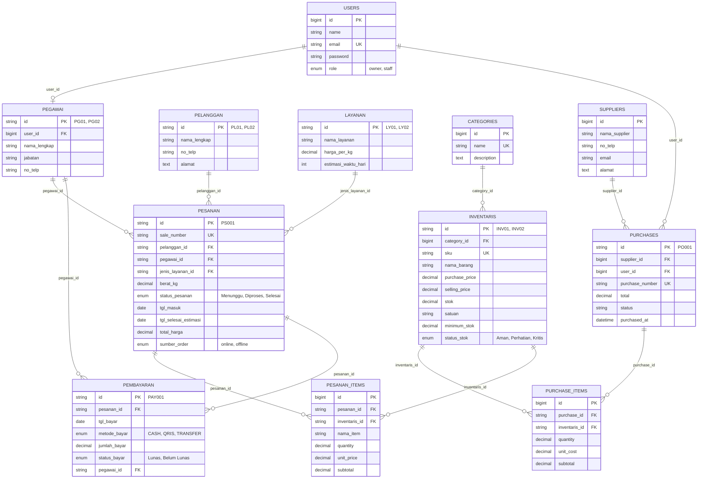

# 🧺 Maudy Laundry - Sistem Informasi Manajemen Laundry Terpadu

> **Tugas Ujian Tengah Semester (UTS) — Mata Kuliah Web Programming 2**  
> Dikerjakan dengan arsitektur **Laravel MVC**, Database **MySQL (Laragon)**, **Eloquent ORM**, autentikasi multi-staf, otorisasi server-side (RBAC), transaksi atomik (`DB::transaction` & `lockForUpdate`), dan pelacakan resi publik mandiri.

---

## 📌 1. Project Overview

**Maudy Laundry** adalah aplikasi web bisnis terintegrasi yang dirancang untuk mengelola proses operasional laundry modern secara konsisten dan transparan. Sistem ini mengintegrasikan seluruh siklus bisnis: mulai dari **pemesanan mandiri oleh pelanggan via website (tanpa login)**, **penerimaan dan verifikasi cucian oleh staf kasir**, **pengurangan bahan baku operasional secara atomik**, **pencatatan pembayaran (Cash/QRIS/Transfer)**, **pengadaan stok bahan (purchases/stock-in) dari supplier**, hingga **pelaporan keuangan terpadu (Harian, Mingguan, Bulanan, Tahunan, dan Detail Transaksi)** dengan format cetak resmi.

### 🎯 3 Hak Akses Utama (3-Tier Access Control):
1. **👑 Owner / Pimpinan**: Akses penuh ke seluruh fitur, laporan laba/pendapatan, manajemen akun multi-pegawai & role, master data tarif, serta wewenang pembatalan transaksi dengan pemulihan stok otomatis (*stock restoration*).
2. **👨‍💼 Staff (Multi-Staff)**: Akses operasional harian menggunakan email & password akun masing-masing. Staf dapat memproses pesanan masuk, mencatat pembayaran, menginput pengadaan stok masuk (*purchase/stock-in*), dan memantau stok inventaris. Setiap transaksi yang ditangani staf secara otomatis merekam `pegawai_id` staf yang sedang login (*multi-staff tracking*). Staf dibatasi di level server (*Server-Side Authorization*) sehingga tidak dapat menghapus data sensitif atau menambah akun staf lain.
3. **🌐 Publik / Pelanggan**: Akses bebas ke landing page publik, daftar harga layanan resmi, form pemesanan laundry mandiri (penjemputan cucian), dan fitur **Cek Status Resi / Tracking Real-Time** (Menunggu → Diproses → Selesai/Siap Diambil) tanpa perlu registrasi akun.

---

## ⚙️ 2. Persyaratan Sistem (System Requirements)

- **PHP**: Versi 8.2 atau yang lebih baru (Disarankan PHP 8.3 / 8.5)
- **Ekstensi PHP**: `pdo`, `pdo_mysql`, `mbstring`, `openssl`, `tokenizer`, `xml`, `ctype`, `json`, `fileinfo`
- **Database**: MySQL 8.0+ atau MariaDB 10.4+ (Bawaan Laragon)
- **Composer**: Versi 2.x
- **Web Server**: Apache / Nginx bawaan Laragon atau `php artisan serve`

---

## 🚀 3. Panduan Instalasi & Setup di Lingkungan Laragon MySQL

Aplikasi ini sudah dipersiapkan secara *zero-configuration* dan dapat langsung dijalankan pada folder `C:\laragon\www\Maudylaundry`:

### Langkah 1: Buka Terminal di Folder Project
```bash
cd C:\laragon\www\Maudylaundry
```

### Langkah 2: Pastikan MySQL di Laragon Sudah Aktif
1. Buka aplikasi **Laragon**.
2. Klik tombol **"Start All"** (pastikan Apache dan MySQL menyala pada port 3306).

### Langkah 3: Konfigurasi File Environment (.env)
File `.env` sudah dikonfigurasi secara default untuk Laragon MySQL:
```env
APP_NAME="Maudy Laundry"
APP_ENV=local
APP_KEY=base64:JnaYG0q1hwCWqqVk5JjMqATbIO9g4lQHBM2h+OolNZM=
APP_DEBUG=true
APP_URL=http://localhost:8000

DB_CONNECTION=mysql
DB_HOST=127.0.0.1
DB_PORT=3306
DB_DATABASE=maudylaundry
DB_USERNAME=root
DB_PASSWORD=
```

### Langkah 4: Eksekusi Inisialisasi Database Otomatis
Kami telah membuat perintah Artisan khusus `laundry:init` yang otomatis membuat database `maudylaundry` di MySQL (jika belum ada), menjalankan migrasi seluruh tabel, dan melakukan seeding data dummy realistis:
```bash
php artisan laundry:init
```
*(Atau jika ingin menjalankan migrasi standar: `php artisan migrate:fresh --seed`)*

### Langkah 5: Jalankan Aplikasi
Jalankan development server Laravel:
```bash
php artisan serve
```
Aplikasi dapat dibuka melalui browser pada: **`http://localhost:8000`**  
*(Atau via Laragon Virtual Host: `http://maudylaundry.test`)*

---

## 🔑 4. Akun Demo Pengujian (Demo Accounts)

Untuk mempermudah dosen penguji dan tim penilai, tersedia tombol **1-Click Auto Fill** di halaman login (`/login`):

| Role | Nama Lengkap | Jabatan | Email Login | Password Default | Hak Akses Utama |
| :--- | :--- | :--- | :--- | :--- | :--- |
| **Owner** | Siti Maudy | Pemilik | `owner@maudylaundry.com` | `password` | Akses Penuh, CRUD Pegawai, Laporan, Batalkan Transaksi |
| **Staff** | Dewi Lestari | Kasir | `staff2@maudylaundry.com` | `password` | Input Pesanan, Catat Bayar, Lihat Stok |
| **Staff** | Rahmat Hidayat | Operator Cuci | `staff1@maudylaundry.com` | `password` | Update Status Cucian, Input Stock-In |
| **Staff** | Agus Setiawan | Operator Setrika | `agus@maudylaundry.com` | `password` | Operasional Cucian |
| **Staff** | Dinda | Teknisi Cuci | `dinda@maudylaundry.com` | `password` | Operasional Cucian |
| **Publik** | Pelanggan | - | *Tanpa Login* | - | Landing Page, Pesan Online, Cek Status Resi |

---

## 🛡️ 5. Matriks Role-Based Access Control (RBAC) Server-Side

Proteksi hak akses diterapkan di level server melalui **`RoleMiddleware`** (`app/Http/Middleware/RoleMiddleware.php`) dan terdaftar di `bootstrap/app.php`:

| Modul / Tindakan | Owner / Pimpinan | Multi-Staff | Publik (Pelanggan) | Catatan Keamanan |
| :--- | :---: | :---: | :---: | :--- |
| **Landing Page & Pesan Online** | ✅ | ✅ | ✅ | Akses publik tanpa autentikasi |
| **Lacak Status Resi Laundry** | ✅ | ✅ | ✅ | Input kode pesanan instan |
| **Dashboard Ringkasan** | ✅ | ✅ | ❌ | Dilindungi middleware `role:owner,staff` |
| **Input Pesanan Offline / Kasir** | ✅ | ✅ | ❌ | Mencatat `pegawai_id` staf yang login |
| **Update Status Pesanan** | ✅ | ✅ | ❌ | Menunggu → Diproses → Selesai |
| **Cetak Nota & Invoice** | ✅ | ✅ | ❌ | Cetak nota digital / thermal |
| **Input Pembayaran (Cash/QRIS)** | ✅ | ✅ | ❌ | Transaksi atomik |
| **Pengadaan Stok (Stock-In)** | ✅ | ✅ | ❌ | Auto tambah stok inventaris |
| **CRUD Master Pelanggan & Layanan**| ✅ | ✅ | ❌ | Dibatasi untuk staf operasional |
| **CRUD Pegawai & Akun Staff** | ✅ | ❌ | ❌ | **Protected `role:owner` (403 Forbidden untuk staf)** |
| **Batalkan Transaksi (Stock Restore)**| ✅ | ❌ | ❌ | **Protected `role:owner`** |
| **Hapus Riwayat Pembayaran** | ✅ | ❌ | ❌ | **Protected `role:owner`** |

---

## 🗄️ 6. Skema Database & Entity Relationship Diagram (ERD)

Struktur tabel memadukan seluruh kebutuhan slide dosen (Products/Inventaris, Categories, Suppliers, Purchases, PurchaseItems, Sales/Pesanan, SaleItems, Users) dengan studi kasus visual Maudy Laundry:



---

## 💡 7. Business Logic & Konsistensi Stok (Inti Penilaian UTS)

Sesuai instruksi pada Slide 7, 8, dan 16 PDF Panduan UTS:

### 1. Transaksi Atomik (`DB::transaction`)
Semua proses mutasi yang melibatkan lebih dari satu tabel (misal pembuatan Header Pesanan + Detail Item Pesanan + Pengurangan Stok Bahan) dibungkus di dalam blok `DB::transaction(function () { ... })`. Jika terjadi galat (*error*) di tengah jalan, seluruh proses dibatalkan (*rollback otomatis*) sehingga tidak akan pernah ada data yang tersimpan setengah jalan.

### 2. Pencegahan Balapan Data & Overselling (`lockForUpdate`)
Ketika staf memproses pesanan atau pembelian stok, sistem mengeksekusi `Inventaris::where(...)->lockForUpdate()->first()` untuk mengunci baris data di tingkat database engine InnoDB. Hal ini mencegah *race condition* jika dua transaksi memproses stok barang yang sama pada detik yang bersamaan.

### 3. Perhitungan Harga Sisi Server (Server-Side Calculation)
Total biaya pesanan (`total_harga = berat_kg * layanan->harga_per_kg`) dihitung murni di server dengan mengambil harga resmi langsung dari database. Sistem **tidak pernah mempercayai input harga dari browser**.

### 4. Penolakan Transaksi Saat Stok Tidak Cukup (Stock Validation)
Sebelum pesanan diproses, sistem menghitung kebutuhan bahan operasional (misal konsentrat deterjen dan plastik kemasan). Jika stok inventaris tidak mencukupi, sistem langsung melempar:
```php
throw ValidationException::withMessages([
    'berat_kg' => "Stok deterjen ({$deterjen->stok}) tidak mencukupi... Transaksi dibatalkan secara atomik.",
]);
```
Data pesanan tidak akan terbuat dan stok tidak akan berkurang sedikit pun.

### 5. Pemulihan Stok Saat Pembatalan Transaksi (*Stock Restoration*)
Jika Owner membatalkan transaksi pesanan yang telah diproses, sistem secara otomatis mengembalikan kuantitas stok bahan baku yang terpakai ke tabel `inventaris` dan memperbarui `status_stok` secara konsisten.

---

## 🎓 8. Jawaban Lengkap Pertanyaan Code Interview UTS (Slide 24)

Berikut adalah panduan jawaban resmi untuk sesi *Code Ownership Interview*:

### 1. *Mengapa `Pesanan` (Sale) memiliki relasi `hasMany` ke `PesananItem` (SaleItem)?*
> **Jawaban:**  
> Sebuah transaksi pesanan (*sales header*) dapat terdiri dari lebih dari satu item rincian (misal paket cuci utama, alokasi deterjen/pewangi khusus, biaya packing plastik, atau perlakuan noda tambahan). Dengan relasi 1:N (*one-to-many*), struktur database berada dalam Bentuk Normal Ketiga (3NF), menghindari redundansi kolom (seperti `item1`, `item2`), serta fleksibel menampung variasi item dan harga satuan historis saat transaksi terjadi.

### 2. *Di mana sistem memastikan stok tidak menjadi negatif?*
> **Jawaban:**  
> Di controller `PesananController.php` (pada metode `store`) dan `PurchaseController.php`. Sebelum stok dikurangi, sistem menjalankan validasi server-side:  
> ```php
> if ($deterjen->stok < $deterjenNeeded) {
>     throw ValidationException::withMessages([...]);
> }
> ```  
> Ditambah dengan constraint tipe data `unsigned` atau pemeriksaan kondisi saat *lock*, data tidak akan pernah dipotong jika saldo akhir lebih kecil dari kebutuhan.

### 3. *Mengapa total penjualan dihitung di server?*
> **Jawaban:**  
> Untuk mencegah manipulasi harga dari sisi klien (*client-side tampering*). Pengguna dapat dengan mudah mengubah nilai tagihan melalui *Inspect Element* atau memodifikasi request HTTP menggunakan cURL/Postman. Dengan menghitung `total_harga = berat_kg * layanan->harga_per_kg` langsung di server, kebenaran nilai finansial 100% terjamin.

### 4. *Apa risiko jika pengurangan stok dilakukan di luar `DB::transaction`?*
> **Jawaban:**  
> Terjadinya inkonsistensi data (*partial execution*). Jika header pesanan berhasil dibuat, namun server mengalami kegagalan (misalnya koneksi putus atau server crash) sebelum stok dikurangi, maka pesanan tercatat tetapi stok riil tidak terpotong. Sebaliknya, jika stok sudah terpotong tetapi pesanan gagal disimpan, inventaris akan hilang tanpa riwayat penjualan. `DB::transaction` menjamin prinsip **ACID** (*Atomicity, Consistency, Isolation, Durability*).

### 5. *Bagaimana mencegah Staff mengakses fungsi Admin/Owner melalui URL langsung?*
> **Jawaban:**  
> Melalui otorisasi server-side menggunakan `RoleMiddleware.php`. Sekadar menyembunyikan tombol di Blade view bukan otorisasi yang aman. Di file `routes/web.php`, route sensitif seperti `Route::resource('pegawai', PegawaiController::class)` dibungkus di dalam grup `Route::middleware('role:owner')`. Jika staf memasukkan URL `/pegawai` secara manual, server akan langsung mencegat request dan mengembalikan kode respon HTTP **403 Forbidden**.

### 6. *Apa yang terjadi jika dua penjualan memproses stok produk yang sama hampir bersamaan?*
> **Jawaban:**  
> Tanpa penguncian baris, akan timbul masalah *concurrency* (*race condition* / *lost update*), di mana kedua transaksi membaca stok yang sama (misal sisa 10 liter) dan sama-sama mengizinkan penjualan, sehingga stok akhir menjadi negatif. Maudy Laundry menggunakan metode `Inventaris::where(...)->lockForUpdate()->first()`. Transaksi pertama akan memegang kunci baris database (*pessimistic lock*), sementara transaksi kedua harus menunggu hingga transaksi pertama selesai (*commit*). Ketika giliran transaksi kedua tiba, ia membaca sisa stok terbaru yang valid.

### 7. *Tunjukkan validasi SKU unik dan jelaskan peran constraint database!*
> **Jawaban:**  
> Validasi di controller melindungi form dari input yang salah:  
> `'sku' => ['required', 'string', 'unique:inventaris,sku']`  
> Sedangkan di migrasi, `$table->string('sku', 50)->unique();` menambahkan *Unique Index Constraint* pada engine MySQL. Constraint database bertindak sebagai garis pertahanan terakhir (*data integrity guard*) yang mencegah duplikasi data bahkan jika ada eksekusi batch atau bypass aplikasi dari luar.

### 8. *Ubah aturan minimum stock dan tunjukkan dampaknya!*
> **Jawaban:**  
> Aturan `status_stok` dikelola secara dinamis di model `Inventaris::updateStatusStok()`:  
> - Jika `stok <= 0` → Status berubah menjadi `Kritis` (badge merah).  
> - Jika `stok <= minimum_stok` → Status berubah menjadi `Perhatian` (badge kuning).  
> - Jika `stok > minimum_stok` → Status menjadi `Aman` (badge hijau).  
> Dampak di antarmuka: Dashboard utama secara otomatis menampilkan barang tersebut di card **"Stok Rendah ⚠️"** dan staf dapat segera menekan tombol **"Kelola Stok"** untuk melakukan pembelian ulang (*stock-in*).

---

## 🧪 9. Bukti Hasil Pengujian Otomatis (Automated Testing)

Aplikasi dilengkapi dengan 13 skenario Feature Test lengkap (`tests/Feature/MaudyLaundryTest.php`):

```bash
php -d extension=pdo_sqlite vendor\phpunit\phpunit\phpunit
```

Hasil eksekusi:
```
{"tool":"phpunit","result":"passed","tests":13,"passed":13,"assertions":38,"duration_ms":1773}
```
Semua 13 pengujian (Autentikasi, Hak Akses RBAC Owner/Staff, Konsistensi Stok Atomik, Penolakan Insufficient Stock, Stock-In Supplier, Pemesanan Mandiri Publik, dan Resi Tracking) **LULUS 100% (Green)**.

---

## 📝 10. Batasan Sistem (Known Limitations)

Sesuai dengan ketentuan ruang lingkup UTS pada Slide 4 dokumen panduan:
1. **Payment Gateway Nyata**: Transaksi pembayaran menggunakan metode pencatatan kasir internal (**CASH, QRIS statis, dan TRANSFER Bank**) tanpa integrasi API Midtrans/Xendit live.
2. **Multi-Warehouse**: Pengelolaan stok difokuskan pada satu gudang/outlet utama Maudy Laundry.
3. **Akuntansi Lanjut**: Menggunakan laporan arus kas kasir dan pendapatan kotor per layanan tanpa jurnal umum akuntansi ganda (*double-entry bookkeeping*).

---

**Dibuat dengan dedikasi untuk Ujian Tengah Semester (UTS) Web Programming 2.**  
*Maudy Laundry — Solusi Laundry Bersih, Cepat, dan Terpercaya.*
